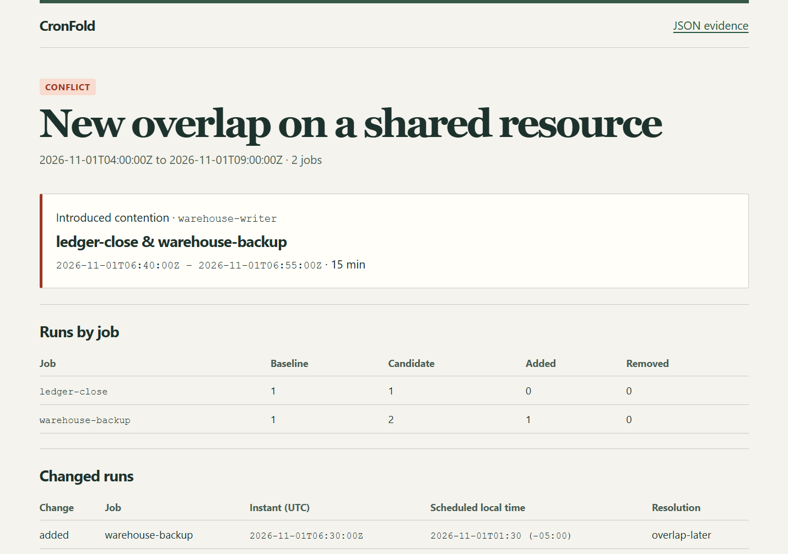

# CronFold

A daily job scheduled for 01:30 in New York can start twice on the morning the clocks go back. If the second run overlaps another writer, a one-line scheduling change can leave two jobs updating the same resource. CronFold compares two plans over a UTC window and reports the added runs, the jobs involved and the precise interval of contention.

CronFold is an offline Kotlin CLI for Java 21. It produces an HTML report for review and JSON evidence that an agent can query over MCP.

## Try the warehouse example

On **November 1, 2026**, the fixture's warehouse backup reserves `warehouse-writer` for 25 minutes. Local 01:30 occurs twice, first at 05:30 UTC and again at 06:30 UTC. The proposed plan switches the backup's overlap policy from `earlier` to `both`. The ledger close takes 20 minutes on the same writer.

| Plan | Backup starts (UTC) | Ledger close starts (UTC) | Result against baseline |
| --- | --- | --- | --- |
| Baseline | 05:30 | 06:40 | **PASS** when compared with itself |
| Candidate | 05:30, 06:30 | 06:40 | **CONFLICT** from 06:40 to 06:55 UTC |
| Fixed | 05:30, 06:30 | 07:00 | **CHANGE** with no writer overlap |

These jobs and durations are a synthetic warehouse workload. The fixed plan keeps both backup runs and postpones the ledger close by 20 minutes. [Example plans](examples/warehouse)



**Read the reports.** Download and extract the [warehouse demo ZIP](https://github.com/Almeida96/cronfold/releases/download/v0.1.0/warehouse-demo.zip). Open `conflict/report.html`, then `fixed/report.html`. The archive also contains both JSON reports and the input plans.

**Run it locally.** Install Java 21, extract the [CLI ZIP](https://github.com/Almeida96/cronfold/releases/download/v0.1.0/cronfold-0.1.0.zip), and run these commands from its `cronfold-0.1.0` directory. On Windows PowerShell the launcher is `.\bin\cronfold.bat`.

```sh
./bin/cronfold demo --out warehouse-demo

./bin/cronfold compare \
  --before warehouse-demo/plans/baseline.json \
  --after warehouse-demo/plans/candidate.json \
  --from 2026-11-01T04:00:00Z --until 2026-11-01T09:00:00Z \
  --out warehouse-review
```

The comparison writes `warehouse-review/report.html` and `report.json` and exits with code `1` for the introduced conflict. Each invocation needs a new output directory. The `demo` command exits successfully when it reproduces both expected results.

## Describe a schedule

Each plan is a JSON object with `version: 1` and a `jobs` array. Job IDs identify the same work across releases. Removing an ID and adding a new one appears as a removal and an addition.

```json
{
  "version": 1,
  "jobs": [
    {
      "id": "warehouse-backup",
      "cron": "30 1 * * *",
      "zone": "America/New_York",
      "durationMinutes": 25,
      "resource": "warehouse-writer",
      "gap": "skip",
      "overlap": "earlier"
    }
  ]
}
```

- **Cron** uses minute, hour, day of month, month and day of week. Fields accept `*`, comma lists, ascending ranges, and steps after a star or range. Month and weekday names such as `JAN` and `MON` are case-insensitive. Sunday is `0` or `7`. When either day field starts with `*`, both day fields must match. Otherwise either can match. For example, `0 9 1 * MON` runs on the first of the month and on Mondays. Quartz extensions, seconds and macros are outside this grammar.
- **Zone** names come from the JVM time-zone database, such as `America/New_York` or `UTC`. For a nonexistent local time, `gap: "skip"` (default) emits no run. `"shift-forward"` moves it by the actual size of the gap. The skipped time appears in the clock events when its nominal time mapped with the old offset falls inside the window. For a repeated local time, `overlap: "earlier"` or `"later"` selects one instant. The default `"both"` emits each. Choose the policies your scheduler uses.
- **Duration and resource** describe an uninterrupted reservation lasting 1–1,440 elapsed minutes after each start. A named resource allows one concurrent reservation. Jobs sharing its exact name compete, and two runs of the same job can also conflict. Omit `resource` to compare a job's starts without reserving anything. Durations are inputs. The model excludes queues, retries, jitter and measured execution time.

### Import Kubernetes CronJobs

Export your CronJobs to JSON and convert that file into a plan.

```sh
kubectl get cronjobs -A -o json > cronjobs.json
./bin/cronfold import-kube --input cronjobs.json --duration 10 --controller-zone UTC --out imported
```

The importer runs offline. You can try it with the [warehouse CronJob export](examples/kubernetes/warehouse.json) in place of `cronjobs.json`. Pass `imported/plan.json` as either side of a comparison. `--duration` sets the assumed runtime in minutes. A job's `cronfold.dev/duration-minutes` annotation overrides it, and `cronfold.dev/resource` opts the job into a named capacity-one resource. Use `--controller-zone` for jobs whose manifests omit a time zone. Review the import notes and gap/overlap assumptions before using the plan to gate a release. Cluster conditions and controller policies affect actual starts.

## Read a comparison in CI

The window includes `--from` and excludes `--until`. Runs match by job ID and UTC instant, keeping multiplicity if two nominal times map to the same instant. An unchanged count alone cannot establish that the timing stayed the same. Clock events retain the nominal local time and offsets. The JSON also records the SHA-256 of each input plan and the time-zone database versions used.

A resource reservation that starts before the window can still collide inside it. Conflicts identify both run starts and report the portion of the overlap inside the window. Reservations that meet at an endpoint are allowed. If two runs already overlap and a duration change extends their overlap, the original interval remains `existing` and the added interval is `introduced`. Removed intervals are `resolved`.

| Result | Default exit | With `--strict` | Meaning |
| --- | --- | --- | --- |
| `PASS` | 0 | 0 | No changes or new contention. Existing overlaps remain visible. |
| `CHANGE` | 0 | 1 | Job settings, runs or overlaps changed, with no introduced contention. |
| `CONFLICT` | 1 | 1 | A candidate pair has a newly overlapping interval. |
| Input or I/O error | 2 | 2 | The comparison did not finish. Read standard error. |

Reports apply to the chosen window and the supplied plans. Each plan supports up to 128 jobs and the window can span up to 366 days. A single projection accepts up to 100,000 runs, 100,000 clock events and 500,000 candidate minutes. The comparison caps total projected runs and events at 300,000, overlapping pairs at 40,000 per plan and evidence rows at 40,000 across both sides. JSON reports are limited to 32 MiB. Shorten the window or narrow the job set if a limit is reached.

## Inspect a report over MCP

Point a stdio client at a saved `report.json`. The server opens that report at startup. Its four tools read the evidence without running the scheduler or accessing a production system.

```json
{
  "mcpServers": {
    "cronfold": {
      "command": "java",
      "args": [
        "-cp", "/opt/cronfold-0.1.0/lib/*",
        "io.github.almeida96.cronfold.MainKt",
        "mcp", "--report", "/work/warehouse-demo/conflict/report.json"
      ]
    }
  }
}
```

Replace both absolute paths for your installation. Ask your agent *“Which run was added when the clocks went back, and for how many minutes does it overlap the ledger close?”*

| Tool | Example arguments | Evidence |
| --- | --- | --- |
| `schedule_summary` | `{}` | Verdict, window, per-job counts and input fingerprints |
| `job_detail` | `{"job":"warehouse-backup","side":"after"}` | Both configurations and the selected side's clock events |
| `list_changes` | `{"job":"warehouse-backup","kind":"added"}` | Changed UTC instants, nominal times and offsets |
| `list_conflicts` | `{"resource":"warehouse-writer","classification":"introduced"}` | Run pairs and their overlapping UTC intervals |

All four tools accept `offset` and `limit` (default 25, maximum 100). Follow `nextOffset` to read the next page.

## Build and verify

Use JDK 21 and the included Gradle wrapper. The first build downloads dependencies.

```sh
./gradlew test installDist distZip
```

Use `.\gradlew.bat` on Windows. The installed launcher is in `build/install/cronfold/bin/`.

The zoneinfo check walks UTC minutes and converts them to local times with Python's `zoneinfo` and the `tzdata` wheel. It compares the resulting executions and transition evidence with the installed CLI across five windows, including New York's repeated hour, Lord Howe's 30-minute change and Apia's skipped date in 2011. [Verification script](checks/zoneinfo_smoke.py)

```sh
python -m pip install tzdata==2025.2
python checks/zoneinfo_smoke.py --install-dir build/install/cronfold
```

The MCP smoke check queries a saved report with the official Python client. [MCP verification](checks/mcp_smoke.py) · [CI runs](https://github.com/Almeida96/cronfold/actions)

[MIT License](LICENSE)
